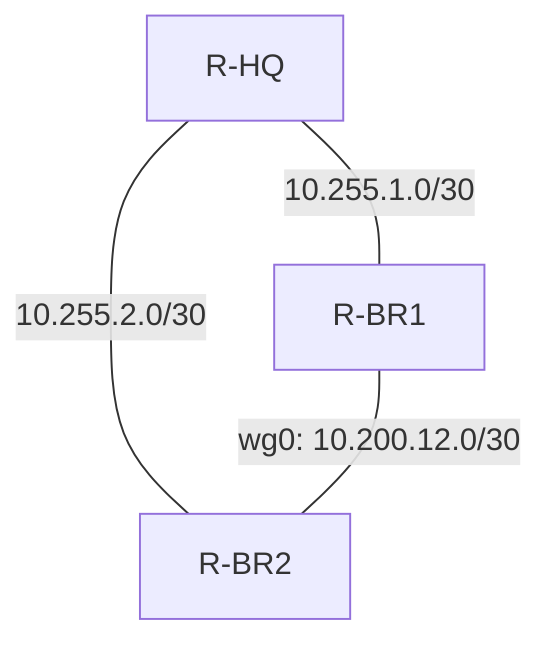

# Ngữ cảnh cho Codex làm báo cáo và slide

Ngày cập nhật: 10/11/2026 (Asia/Ho_Chi_Minh). Repo: hippozee/DoAn-EVE-NG.

## Mục tiêu và phạm vi

Xây dựng mô hình trụ sở HQ và hai chi nhánh BR1, BR2 trên EVE-NG; dùng OSPF trao đổi tuyến, có kết nối trực tiếp giữa chi nhánh qua wg0, quan sát trạng thái bằng Zabbix và thử nghiệm phát hiện độ trễ bất thường bằng Isolation Forest.

Tên đề tài làm việc: **Xây dựng mô hình mạng nhiều cơ sở có kết nối bảo mật và giám sát bất thường bằng Zabbix kết hợp AI trên EVE-NG**. Tên chính thức, tên sinh viên, giảng viên, lớp và mẫu trình bày phải lấy từ thông tin người dùng xác nhận; không suy từ tài khoản GitHub.

## Thứ tự sử dụng nguồn

- Mã AI thực tế đã nhận từ bản sao VM ngày 10/11: đọc [ai/README.md](../ai/README.md), manifest và [log T10 gốc](../evidence/ai/2026-11-10/test-RTT-BR1.log). Gói qua kiểm tra gzip/tar; không có credentials.json. Đây là đối chiếu bản xuất, chưa truy cập VM hiện tại.
- Cập nhật dashboard, đồng hồ và kiểm thử T10: đọc PROGRESS_2026-11-10.md và docs/tests/T10_RTT_BR1_2026-11-10.md.
- Trạng thái ngày 09/11: dựa ảnh và nhật ký người dùng gửi, được ghi trong PROGRESS_2026-11-09.md.
- Cấu hình lưu trong repo: snapshot tại commit c04f55196230c5aff2c9e0d1dcb5845d40b3ef2f, trước lần bổ sung tài liệu này.
- Khuyến nghị hoặc thiết kế chưa kiểm thử phải ghi là dự kiến.
- Trước khi xuất báo cáo cuối, đối chiếu lại snapshot với lab, đọc tài liệu Word và hướng dẫn trình bày của trường.
- Khi hai nguồn khác nhau, nêu thời điểm và điểm khác nhau; không tự ghép thành một cấu hình đã xác nhận.
- Không đánh dấu hoàn thành chỉ vì có hướng dẫn cài đặt, item hoặc dịch vụ.

## Công nghệ có căn cứ

Topology .unl đặt image router là linux-debian12-frr; snapshot HQ/BR1/BR2 ghi FRR 8.4.4. Vì vậy phần triển khai hiện tại mô tả **router Linux/FRR**, không mặc định Cisco IOL từ giai đoạn cũ.

| Thành phần | Vai trò | Căn cứ |
|---|---|---|
| EVE-NG | Mô phỏng các node, LAN, WAN | .unl |
| Debian 12 / FRR 8.4.4 | Router OSPF | .unl và bản xuất FRR |
| WireGuard / wg0 | Kết nối logic BR1–BR2 | Interface wg0 và tuyến qua wg0 trong snapshot; cần bổ sung handshake/cấu hình đã che khóa |
| Zabbix 7.0.31 | Thu thập ICMP, lịch sử và API | Ảnh ngày 09/11 |
| Python 3.11 trong venv | Chương trình phân tích | Đường dẫn site-packages trong ảnh |
| NumPy, scikit-learn, requests | Tính toán, Isolation Forest và API | Ảnh thư viện và chạy chương trình |

## Topology logic theo snapshot

Đây là sơ đồ kết nối logic; wg0 chạy trên underlay Net-ISP 172.16.50.0/24. Không vẽ wg0 như một dây vật lý riêng.

| Node | Giao diện | Địa chỉ | Vai trò |
|---|---|---|---|
| HQ | ens3 | 10.10.10.1/24 | LAN HQ |
| HQ | ens4 | 10.255.1.1/30 | WAN tới BR1 |
| HQ | ens6 | 10.255.2.1/30 | WAN tới BR2 |
| BR1 | ens3 | 10.10.20.1/24 | LAN BR1 |
| BR1 | ens4 | 10.255.1.2/30 | WAN tới HQ |
| BR1 | ens6 | 172.16.50.1/24 | Underlay BR1–BR2 |
| BR1 | wg0 | 10.200.12.1/30 | Tunnel BR1–BR2 |
| BR2 | ens3 | 10.10.30.1/24 | LAN BR2 |
| BR2 | ens4 | 10.255.2.2/30 | WAN tới HQ |
| BR2 | ens6 | 172.16.50.2/24 | Underlay BR1–BR2 |
| BR2 | wg0 | 10.200.12.2/30 | Tunnel BR1–BR2 |

Nguồn: HQ_CHECK.txt, BR1_check.txt, BR2_CHECK.txt. Tên e0/e1/e3 trong EVE khác tên ens3/ens4/ens6 trong Linux; xác nhận MAC/interface trước thao tác thật.

Node .unl còn có VPC, VPC-BR1, VPC-BR2, SERVER-HQ và SERVER-ZABBIX. SERVER-HQ và SERVER-ZABBIX nối Net-HQ và pnet0/Net-Internet. Chưa có bản xuất cấu hình server đầy đủ để chốt toàn bộ địa chỉ, route hoặc vai trò NAT.

## OSPF và đường ưu tiên

- Router-ID: HQ 10.255.0.1, BR1 10.255.0.2, BR2 10.255.0.3.
- LAN ens3 passive; WAN tới HQ cost 10, point-to-point.
- wg0 cost 5, network non-broadcast, hello 2 giây, dead 8 giây, neighbor chỉ định ở BR1/BR2.
- Snapshot BR1 có tuyến 10.10.30.0/24 qua 10.200.12.2, wg0, FRR metric [110/6]; BR2 có chiều ngược lại tương ứng.
- Snapshot Linux ip route in metric 20, khác cách thể hiện cost FRR. Không dùng con số Linux metric 20 để diễn giải tổng OSPF cost.
- Chi phí OSPF giải thích lựa chọn tuyến; không tự chứng minh lưu lượng thực, failover, hay phần trăm tiết kiệm băng thông.
- HQ là vai trò quản trị/nghiệp vụ. OSPF cùng area không tự tạo đặc quyền truy cập hoặc ưu tiên lưu lượng cho HQ.

## Bảo mật và QoS

Sự có mặt wg0 và route là căn cứ cho đường đi logic; cần wg show với handshake mới và cấu hình đã che khóa để kết luận tunnel hoạt động đúng. Không khẳng định HQ–BR1/HQ–BR2 cũng được mã hóa nếu chưa có minh chứng.

Commit trước bổ sung docs có thông điệp về chặn BR1/BR2 tới HQ, nhưng các bản FRR/route đã đọc không chứa đầy đủ firewall policy. Cần xuất ruleset và kiểm thử dịch vụ được phép/bị chặn. Ảnh mang tên qos_test chưa được xem trong đợt này; không suy tốc độ/hiệu quả từ tên tệp.

## Địa chỉ truy cập trong phiên 09/11

- EVE-NG: http://192.168.30.129/legacy/
- Zabbix: http://192.168.30.140/zabbix/
- API trên chính server: http://127.0.0.1/zabbix/api_jsonrpc.php

Đây là địa chỉ riêng của lab, có thể đổi theo môi trường. GitHub access không đồng nghĩa có quyền hoặc đường mạng vào lab. Không hứa đã cấu hình trực tiếp VM khi chỉ có ảnh người dùng thao tác.
